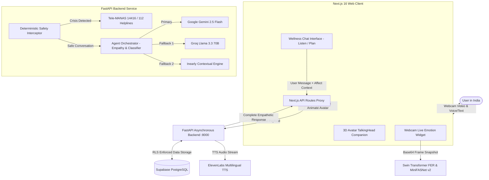

# Inearly — AI Mental Wellness Sanctuary & Confidential Companion

[-black?style=flat&logo=next.js)](https://nextjs.org/)
[](https://fastapi.tiangolo.com/)
[](https://ai.google.dev/)
[](https://groq.com/)
[](https://supabase.com/)
[-0A84FF?style=flat)](#3-zero-pii--dpdp-act-2023-privacy-architecture)
[](#the-team--team-phantomx)

> **Inearly** is an AI-powered mental wellness sanctuary and confidential companion platform built specifically for India. Designed for youth, college students, and young professionals navigating academic pressure, placement anxiety, relationship heartbreak, and everyday overwhelm, Inearly delivers culturally attuned, empathetic, and confidential support 24/7 without judgment or stigma.

---

## 👥 The Team — Team PhantomX

Inearly was conceptualized, designed, and engineered by **Team PhantomX**:

| Member | Role | Core Contributions |
| :--- | :--- | :--- |
| **Harsh Kasaudhan** | Full-Stack AI Engineer | Architecture, FastAPI backend, Multi-LLM orchestration, Vision & FER pipeline |
| **Ankur Singh** | Frontend & UI/UX Engineer | Next.js architecture, 3D avatar companion integration, Glassmorphism design |
| **Deepak Verma** | Systems & Privacy Engineer | DPDP Act compliance, Zero-PII cryptography, Database schemas & RLS policies |
| **Ram Vijay** | ML & Affective Computing | MiniFASNet v2 anti-spoofing, Swin Transformer FER fine-tuning, Telemetry |

---

## 🌟 Key Features

### 1. Real-Time Facial Emotion Recognition (FER) & Liveness Perception
- **Lightweight Computer Vision Pipeline**: Integrated Swin Transformer FER model (`SEARO1/FER_model`) coupled with MiniFASNet v2 anti-spoofing telemetry.
- **7-Emotion Spectrum**: Dynamically classifies real-time facial affect into `Calm`, `Happy`, `Sad`, `Fear`, `Angry`, `Disgust`, and `Surprise` with continuous confidence scoring.
- **Affective Multimodal Prompt Injection**: Live emotional insights (e.g. physiological tension, fear, or crying/fatigue) are seamlessly woven into the companion's system prompt so responses match the user's real affective state.
- **Privacy-First & Non-Intrusive**: Runs strictly on consensual client-side video frames. Raw video frames and facial coordinates are processed ephemerally in RAM and **never stored or persisted to disk**.

### 2. Interactive 3D Companion Avatar & Dual Conversational Modes
- **Expressive 3D Character**: Interactive 3D TalkingHead companion with natural micro-movements, eye blinks, gentle head nods, and realistic lip-syncing.
- **High-Fidelity Voice Synthesis**: Employs ElevenLabs neural multilingual TTS and browser-native speech synthesis for comforting, calming audio feedback.
- **Dual Conversational Modes**:
  - **"Just Listen" Mode**: Focused purely on empathetic validation, emotional holding space, and non-prescriptive compassionate inquiry (no unsolicited advice).
  - **"Help Me Plan" Mode**: Co-creates exactly 1–2 manageable, low-pressure coping micro-actions (e.g., 4-4-4 pranayama breath reset, 10-minute focus boxes, somatic grounding).
- **Multilingual & Culturally Grounded**: Native code-switching across **Hinglish**, **Hindi**, and **English**, addressing nuanced Indian experiences (JEE/NEET burnout, campus placement comparisons, family expectations, and relationship grief).

### 3. Zero-PII & DPDP Act (2023) Privacy Architecture
- **Zero Direct PII**: Does not collect or store legal names, email addresses, phone numbers, or national identification numbers.
- **Coarse Demographic Bands**: Uses broad age intervals (`13-17`, `18-24`, `25-34`, `35-49`, `50+`) instead of precise birthdates.
- **Granular Revocable Consent**: Dedicated `consents` lifecycle tracking table recording purpose-specific grant and withdrawal timestamps.
- **Client-Side Envelope Encryption**: Messages and transcripts are protected using AES-256 envelope encryption with a 32-byte secret key.
- **One-Click Instant Purge**: Complete user-controlled data erasure that removes all conversation history, messages, and tags with a single click.
- **Tentative AI Tagging**: Diagnostic concern tags inferred by AI are explicitly stored with `tentative_flag=true` until voluntarily confirmed by the user.
- **Deterministic Crisis Interceptor**: High-speed keyword triage engine that automatically bypasses LLMs during acute crisis messages to display verified 24/7 Indian crisis helplines (Tele-MANAS `14416`, Emergency `112`, KIRAN `1800-599-0019`, Vandrevala Foundation).

### 4. Resilient FastAPI Multi-Model Backend
- **High-Performance Python Service**: Built on FastAPI 0.115 and Pydantic v2 with non-blocking asynchronous I/O.
- **Multi-Model LLM Redundancy**:
  1. **Primary**: Google Gemini 2.5 Flash with extended 2048-token completion limits and completion mandates.
  2. **Secondary Fallback**: Groq Llama 3.3 70B Versatile for ultra-low latency response failover.
  3. **Tertiary Fallback**: Inearly Contextual Dynamic Empathy Engine for fully offline high-availability support.
- **Database Layer**: Supabase PostgreSQL with Row-Level Security (RLS) enforcing strict user-isolation policies.

### 5. Next.js 16 Frontend with Tailwind CSS
- **Modern Web Stack**: Next.js 16 (App Router), React 19, TypeScript, and Tailwind CSS v4.
- **Calm, Glassmorphic UI**: Ambient dark-mode interface with emerald/teal wellness tones designed to reduce visual strain and anxiety.
- **Live Affect Indicator**: Real-time emerald status badges displaying verified live presence and dominant emotion without intrusive alerts.

---

## 🏛️ System Architecture



---

## 📁 Repository Structure

```
inearly/
├── backend/                             # Python FastAPI Backend
│   ├── app/
│   │   ├── api/v1/endpoints/           # REST endpoints (chat, face, health, consent)
│   │   │   ├── chat.py                 # Chat interactions & session persistence
│   │   │   ├── face.py                 # Face frame analysis & emotion inference
│   │   │   ├── health.py               # Detailed service health telemetry
│   │   │   └── consent.py              # DPDP Act consent management
│   │   ├── core/                       # Core settings, security headers & config
│   │   ├── db/                         # Supabase database client
│   │   ├── schemas/                    # Pydantic v2 validation models
│   │   ├── services/                   # Business logic
│   │   │   ├── agents.py               # Gemini 2.5 Flash & Groq Llama 3 orchestrator
│   │   │   ├── face_analysis_service.py# Swin Transformer FER & MiniFASNet v2
│   │   │   ├── safety_interceptor.py   # Deterministic crisis detection
│   │   │   └── tts_service.py          # ElevenLabs neural audio streaming
│   │   └── main.py                     # FastAPI application entry point
│   ├── tests/                          # Automated backend test suites
│   ├── requirements.txt                # Python package dependencies
│   └── .env.example                    # Backend environment template
│
├── frontend/                            # Next.js 16 Web Application
│   ├── src/
│   │   ├── app/                        # Next.js App Router pages & API routes
│   │   │   ├── api/v1/chat/route.ts    # Chat proxy route with Groq fallback
│   │   │   ├── api/v1/face/route.ts    # Facial perception proxy route
│   │   │   ├── chat/page.tsx           # Full wellness chat space page
│   │   │   ├── layout.tsx              # Root HTML & metadata layout
│   │   │   └── page.tsx                # Landing sanctuary & feature highlights
│   │   ├── components/                 # Reusable React components
│   │   │   ├── WellnessChatSpace.tsx   # Core chat container & multimodal state
│   │   │   ├── LiveEmotionCompanionWidget.tsx # Webcam emotion widget
│   │   │   ├── CompanionAvatarViewer.tsx      # 3D TalkingHead avatar
│   │   │   └── ConsentBanner.tsx       # DPDP Act compliant consent banner
│   │   └── lib/                        # Client-side storage & cryptographic utilities
│   ├── package.json                    # Node dependencies & npm scripts
│   ├── tsconfig.json                   # TypeScript configuration
│   └── .env.example                    # Frontend environment template
│
├── supabase/                            # Database Migrations & Schemas
│   └── migrations/
│       └── 20261027000000_init_inearly_schema.sql # 5 core tables, RLS & retention
│
├── .gitignore
└── README.md
```

---

## 🚀 Installation & Setup Guide

### Prerequisites
Before running Inearly locally, ensure you have the following installed:
- **Node.js**: `v18.0+` (Recommended: `v20+` or `v22+`)
- **Python**: `3.10+` (Tested on `3.11`, `3.12`, and `3.13`)
- **Git**
- *(Optional)* A free [Supabase](https://supabase.com/) account, [Google AI Studio API Key](https://aistudio.google.com/), and [Groq Cloud API Key](https://console.groq.com/).

---

### Step 1: Clone the Repository

```bash
git clone https://github.com/HarshKasaudhan/InEarly.git
cd InEarly
```

---

### Step 2: Backend Setup (FastAPI)

1. **Navigate to the backend directory**:
   ```bash
   cd backend
   ```

2. **Create and activate a Python virtual environment**:
   - **Windows (PowerShell)**:
     ```powershell
     python -m venv .venv
     .venv\Scripts\Activate.ps1
     ```
   - **macOS / Linux**:
     ```bash
     python3 -m venv .venv
     source .venv/bin/activate
     ```

3. **Install dependencies**:
   ```bash
   pip install --upgrade pip
   pip install -r requirements.txt
   ```

4. **Configure environment variables**:
   Create a `.env` file from `.env.example`:
   - **Windows**: `copy .env.example .env`
   - **macOS / Linux**: `cp .env.example .env`

   Edit `backend/.env` with your API keys:
   ```env
   PROJECT_NAME="Inearly Backend"
   ENVIRONMENT="development"
   DEBUG=true

   # Supabase Configuration
   SUPABASE_URL="https://your-project-id.supabase.co"
   SUPABASE_ANON_KEY="your-anon-public-key"
   SUPABASE_SERVICE_ROLE_KEY="your-service-role-secret-key"

   # Cryptographic Envelope Key (32-byte Base64 key)
   APP_ENCRYPTION_KEY="your-base64-encoded-32-byte-key"

   # LLM Orchestration Keys
   GEMINI_API_KEY="your-gemini-api-key"
   GEMINI_MODEL="gemini-2.5-flash"

   GROQ_API_KEY="your-groq-api-key"
   GROQ_MODEL="llama-3.3-70b-versatile"

   # Optional: ElevenLabs TTS
   ELEVENLABS_API_KEY="your-elevenlabs-api-key"
   ```

5. **Start the FastAPI backend server**:
   ```bash
   uvicorn app.main:app --reload --port 8000
   ```
   - API Root: `http://localhost:8000`
   - Interactive Swagger Docs: `http://localhost:8000/docs`
   - Health Telemetry: `http://localhost:8000/api/v1/health`

---

### Step 3: Frontend Setup (Next.js)

1. **Open a new terminal and navigate to the frontend directory**:
   ```bash
   cd frontend
   ```

2. **Install Node packages**:
   ```bash
   npm install
   ```

3. **Configure frontend environment variables**:
   Create a `.env.local` file from `.env.example`:
   - **Windows**: `copy .env.example .env.local`
   - **macOS / Linux**: `cp .env.example .env.local`

   Edit `frontend/.env.local`:
   ```env
   # Backend API Endpoint
   NEXT_PUBLIC_BACKEND_URL="http://localhost:8000"

   # Supabase Public Keys
   NEXT_PUBLIC_SUPABASE_URL="https://your-project-id.supabase.co"
   NEXT_PUBLIC_SUPABASE_ANON_KEY="your-anon-public-key"

   # Optional Edge Groq Fallback
   GROQ_API_KEY="your-groq-api-key"
   GROQ_MODEL="llama-3.3-70b-versatile"
   ```

4. **Start the Next.js development server**:
   ```bash
   npm run dev
   ```

5. **Access the application**:
   Open your browser and navigate to:
   - **Web Sanctuary**: `http://localhost:3000`
   - **Chat Companion**: `http://localhost:3000/chat`
   - **Frontend Health Check**: `http://localhost:3000/api/health`

---

## 🔒 Privacy & DPDP Act (2023) Compliance Matrix

| DPDP Principle | Technical Implementation in Inearly |
| :--- | :--- |
| **Data Minimization** | No real names, phone numbers, email addresses, or government IDs stored anywhere in the platform. |
| **Pseudonymity** | Every user operates under random pseudonyms (`anon-user-*`) and client-generated UUIDs. |
| **Age Banding** | Users select broad generational brackets (`18-24`, etc.) rather than disclosing exact dates of birth. |
| **Purpose-Specific Consent** | Independent consent toggles for chat storage, 3D companion presence, and facial affect perception. |
| **Right to Erasure** | Users can permanently purge all stored conversations, messages, and tags with a single click. |
| **Ephemeral Perception** | Video frames captured via webcam are evaluated in RAM for emotion scoring and immediately discarded. |
| **Tentative Tagging** | Algorithmic concern classification is marked tentative and never treated as a psychiatric diagnosis. |

---

## 🆘 Verified National Helplines (India)

Inearly includes deterministic safety routing for users experiencing acute distress or self-harm ideation:

| Helpline | Contact Number | Availability | Languages |
| :--- | :--- | :--- | :--- |
| **Tele-MANAS** (Ministry of Health & Family Welfare) | `14416` / `1800-891-4416` | 24/7 Free & Confidential | 20+ Indian Languages |
| **National Emergency Helpline** | `112` | 24/7 Immediate Dispatch | All States & UTs |
| **KIRAN Mental Health Helpline** (DEPwD) | `1800-599-0019` | 24/7 Toll-Free | Multi-lingual |
| **Vandrevala Foundation** | `+91 9999 666 555` | 24/7 Free Counseling | Hindi, English & Regional |

---

## 📄 Medical & Clinical Disclaimer

> **IMPORTANT**: Inearly is an AI-powered emotional wellness sanctuary and supportive conversational companion. It is **not** a licensed medical provider, psychiatrist, or emergency response service. It does **not** provide clinical diagnosis, psychiatric evaluations, or medication prescriptions. If you or someone you know is in crisis or danger, please contact Tele-MANAS (`14416`) or call `112` immediately.

---

## 📜 License

Distributed under the MIT License. See `LICENSE` for more information.

Built with care and empathy by **Team PhantomX**.
